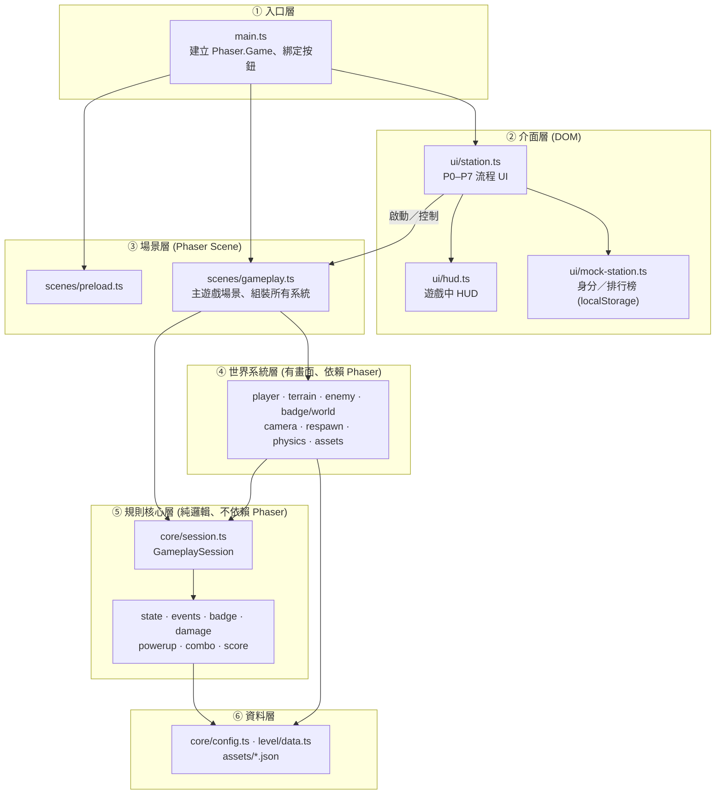
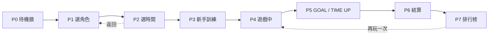

# ROG FUTURE GAMER — Experience 3：Q 版橫向卷軸 Web Game

以 **Phaser 3 + TypeScript + Vite** 打造的 2D 橫向卷軸灰盒（Greybox）遊戲，設計給展場 Kiosk「Station」使用：玩家選角、選時間、闖關收集 ROG 徽章，最後結算分數並上排行榜。

> 目前規則狀態為 `test-only`（見 `src/core/config.ts` 的 `TEST_PROFILE`），尚有待決議規則 `C3, B1, B5, B6, B10, B11`。

---

## 快速開始

| 指令 | 用途 |
|---|---|
| `npm install` | 安裝依賴 |
| `npm run dev` | 啟動開發伺服器（`127.0.0.1`） |
| `npm run build` | 型別檢查 + 打包（`index.html`、`prototype.html` 兩個入口） |
| `npm run typecheck` | 只跑 TypeScript 型別檢查 |
| `npm test` | Vitest 單元 + 整合測試 |
| `npm run test:browser` | Playwright 瀏覽器端測試 |
| `npm run assets:stage` | 將角色／徽章素材整理到 `public/` |

| 入口網址 | 說明 |
|---|---|
| `/` | 正式 Station 模式（完整 P0–P7 流程） |
| `/?debug=1` | 除錯模式：跳過 Station UI，直接進入遊戲；加 `&hz=60` 可改為 60Hz 物理 |
| `/prototype.html` | UI 原型頁（只渲染 HUD，不跑 Phaser） |

---

## 技術棧

| 類別 | 使用技術 | 版本 |
|---|---|---|
| 遊戲引擎 | Phaser（Arcade Physics，Canvas 渲染） | 3.90.0 |
| 語言 | TypeScript | 5.9.3 |
| 建置工具 | Vite | 7.3.7 |
| 事件系統 | eventemitter3 | 5.0.4 |
| 測試 | Vitest（unit / integration）、Playwright（browser） | 4.1.11 / 1.58.2 |
| 規格管理 | OpenSpec（`openspec/specs/`） | — |

---

## 架構總覽

### 分層架構圖

**設計重點：** 第 ⑤ 層「規則核心」完全不碰 Phaser，所以計分、受傷、徽章掉落等規則可以直接用 Vitest 測試；畫面相關的東西都留在第 ④ 層。

### 各層職責

| 層級 | 目錄 | 職責 | 是否依賴 Phaser |
|---|---|---|---|
| ① 入口層 | `src/main.ts` | 建立遊戲實例、註冊場景、綁定 Start/Pause/Home 按鈕、視窗失焦自動暫停 | ✅ |
| ② 介面層 | `src/ui/` | Station 的 DOM 介面（選角、選時間、結算、排行榜）與 HUD | 部分 |
| ③ 場景層 | `src/scenes/` | 素材預載、主遊戲場景；固定步長迴圈、組裝各系統 | ✅ |
| ④ 世界系統層 | `src/player` `terrain` `enemy` `badge/world` `camera` `respawn` `physics` `assets` | 場景中的物件、碰撞、移動與表現 | ✅ |
| ⑤ 規則核心層 | `src/core` `badge/system` `damage` `powerup` `combo` `score` | 回合狀態、計時、計分、事件，純 TypeScript | ❌ |
| ⑥ 資料層 | `src/core/config.ts` `src/level/data.ts` `assets/*.json` | 調校參數、關卡資料、素材清單 | ❌ |

---

## 模組說明

### 核心（`src/core/`）

| 檔案 | 主要匯出 | 說明 |
|---|---|---|
| `config.ts` | `TEST_PROFILE` | 所有可調參數集中處：解析度 960×540、重力、速度、衝刺、物理 24Hz、分數、Combo 倍率等 |
| `state.ts` | `GameplayStateMachine`、`RunStateManager` | 前者管 Station 流程 P0–P7 的合法轉換；後者管單局狀態（running / paused / respawning / goal-reached / time-up / finished）與計時 |
| `session.ts` | `GameplaySession`、`GameplayResult` | **一局遊戲的規則中樞**：整合徽章、傷害、道具、Combo、分數，最後產出凍結的結算結果 |
| `events.ts` | `GameplayEventBus` | 遊戲事件匯流排（受傷、拾取徽章、擊敗敵人、抵達終點、時間到…） |
| `fixed-step.ts` | `FixedStepController` | 固定步長累加器，讓物理在 24Hz 下穩定、與畫面幀率脫鉤 |

### 規則系統（純邏輯）

| 檔案 | 類別 | 說明 |
|---|---|---|
| `badge/system.ts` | `BadgeSystem` | 持有徽章數量、受傷散落（上限 10）、拾取延遲 |
| `damage/system.ts` | `DamageSystem` | 判斷受傷結果：無敵 / 散落徽章 |
| `powerup/system.ts` | `PowerUpSystem` | 道具：`laptop`、`ally`（放大 1.5 倍） |
| `combo/system.ts` | `ComboSystem` | 連擊計數與倍率（1 → 1.2 → 1.5 → 2 → 2.5） |
| `score/engine.ts` | `ScoreEngine` | 擊敗敵人、徽章、剩餘時間的分數結算與明細 |

### 世界系統（Phaser 相關）

| 檔案 | 類別／函式 | 說明 |
|---|---|---|
| `player/controller.ts` | `PlayerController` | 角色狀態機：IDLE / RUN / JUMP / DOUBLE_JUMP / DASH / HURT / FALL / WIN |
| `input/adapter.ts` | `InputAdapter` | 鍵盤 + 搖桿統一成 `Actions`（含 deadzone） |
| `physics/step.ts` | `stepPhysics` | 手動驅動 Arcade Physics 一步 |
| `terrain/system.ts` | `TerrainSystem` | 地形：地面、平台、單向、移動、彈跳、斜坡 |
| `enemy/system.ts` | `EnemySystem` | 敵人：近戰 `melee`、遠程 `ranged`、無人機 `drone` |
| `badge/world.ts` | `BadgeWorld` | 場景中的徽章物件與拾取判定 |
| `camera/manager.ts` | `CameraManager` | 鏡頭跟隨與邊界 |
| `respawn/manager.ts` | `RespawnManager` | 掉坑後找安全點重生 |
| `level/data.ts` | `LEVEL`、`TUTORIAL_LEVEL`、`validateLevel` | 正式關卡（寬 4000）與新手訓練關（寬 1600）資料 |
| `assets/characters.ts` | `CharacterView` | 三位角色（aria / kael / riven）的動畫呈現 |
| `assets/laboratory.ts` | `laboratory` | 實驗室場景背景佈置 |

### 介面（`src/ui/`）

| 檔案 | 說明 |
|---|---|
| `station.ts` | `StationUI`：Kiosk 主流程控制器，渲染每個階段畫面、處理鍵盤／搖桿焦點 |
| `mock-station.ts` | `MockStation`：模擬後端，身分佇列與排行榜存在 `localStorage`（`rog-future-gamer.records.v1`） |
| `hud.ts` | 遊戲中 HUD（時間、徽章、分數） |
| `components.ts` | HTML 小元件（按鈕、面板、頭像），內含 `escape` 防 XSS |
| `design-system/` | 設計 Token（`tokens.css`）與設計說明 |
| `prototype.ts` | `prototype.html` 使用的 UI 原型 |

---

## Station 流程（P0–P7）

| 階段 | 畫面 | 說明 |
|---|---|---|
| P0 | 待機牆 | 輪播玩家紀錄；有玩家排入後自動進 P1 |
| P1 | 選擇角色 | aria / kael / riven，輸入暱稱（最多 24 字） |
| P2 | 選擇時間 | 60 秒（挑戰）／90 秒（標準）／120 秒（休閒） |
| P3 | 新手訓練場 | 素材載入中可先在訓練關練習（不計分） |
| P4 | 遊戲中 | 正式關卡 + HUD |
| P5 | 結束畫面 | GOAL! 停留 5 秒，TIME UP 停留 3 秒 |
| P6 | 結算 | 分數明細與稱號 |
| P7 | 排行榜 | 可開啟 Replay，倒數 3 秒後直接回 P4 |

> 合法轉換規則寫在 `GameplayStateMachine.transition()`：只能前進一步、任意回 P0、P2→P1、P7→P4。

---

## 一局遊戲的資料流

| 步驟 | 發生位置 | 說明 |
|---|---|---|
| 1. 開局 | `GameplayScene.create()` | 建立 `GameplaySession`、載入關卡、組裝各系統 |
| 2. 每幀 | `GameplayScene.update()` | `FixedStepController` 把畫面時間切成 24Hz 固定步 |
| 3. 每個固定步 | 輸入 → 玩家 → 物理 → 地形/敵人/徽章 | 世界系統偵測碰撞 |
| 4. 規則判定 | `session.pickup / hit / credit / respawn` | 世界系統呼叫 Session，規則核心決定結果並發出事件 |
| 5. 結束 | `session.finish('goal' \| 'time-up')` | 結算分數，產出不可變的 `GameplayResult` |
| 6. 結果呈現 | `StationUI` | 寫入排行榜，進入 P5 → P6 → P7 |

---

## 目錄結構

| 路徑 | 內容 |
|---|---|
| `src/` | 遊戲原始碼（見上方模組說明） |
| `assets/` | 素材清單：`character-manifest.json`、`badge-manifest.json` |
| `public/` | 執行時素材（由 `npm run assets:stage` 產生，不進版控） |
| `tests/unit/` | 規則、控制器、關卡、排行榜、UI 的單元測試 |
| `tests/integration/` | `run-loop.test.ts`：完整一局流程 |
| `tests/browser/` | Playwright：移動、地形、斜坡、徽章、Station、UIUX 等 |
| `tools/` | 素材整理腳本（`stage-assets.mjs`、`inspect-character-assets.py`） |
| `docs/` | 需求審查、素材盤點、測試設定、UIUX 報告、交付紀錄 |
| `openspec/specs/` | 12 項能力規格（runtime、player-input、physics-terrain、enemy、station-ui…） |

---

## 測試

| 類型 | 位置 | 執行 | 涵蓋 |
|---|---|---|---|
| 單元 | `tests/unit/` | `npm run test:unit` | 規則核心、玩家控制器、關卡驗證、排行榜、UI 元件 |
| 整合 | `tests/integration/` | `npm run test:integration` | 從開局到結算的完整迴圈 |
| 瀏覽器 | `tests/browser/` | `npm run test:browser` | 真實 Phaser 執行下的移動、碰撞、流程與畫面 |

---

## 相關文件

| 文件 | 說明 |
|---|---|
| `docs/test-profile.md` | `TEST_PROFILE` 參數說明 |
| `docs/requirements-review.md` | 需求審查與待決議事項 |
| `docs/blocker-resolution-2026-10-15.md` | 2026-10-15 已核准規則（計分、散落上限、24Hz） |
| `docs/gameplay-delivery.md` | 玩法交付紀錄 |
| `docs/uiux-integration-report.md` | UI/UX 整合報告 |
| `docs/asset-inventory.md` | 素材盤點 |
| `src/ui/design-system/DESIGN.md` | UI 設計系統 |
